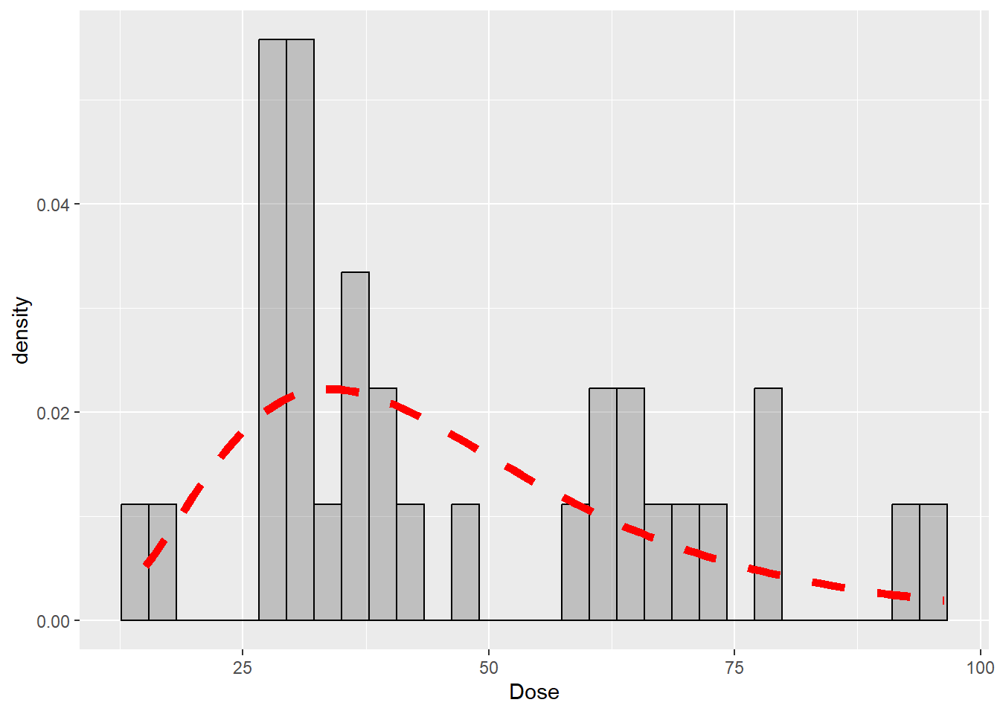
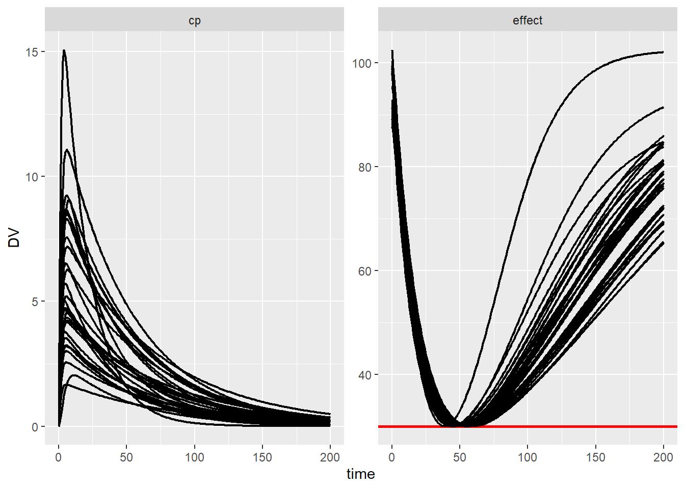

In the previous tutorial [optiDoseR in nlmixr2](nlmixr2-warfarin.qmd), the dose for the typical patient from the warfarin PKPD project was estimated. However, PKPD parameters were estimated with inter-individual variability for 32 patients. In this tutorial, individual doses are estimated for all 32 patients.

## Setting up the OptiProject

We assume, that we already have fitted the warfarin PKPD data set with nlmixr2, as in the previous tutorial.

We set up once again the OptiProject. Note that in the previous tutorial, the elements were added separately, but we can add them all together in a pipe.

```{r, eval=FALSE}
warfProj <- newOptiProject("nlmixr2") %>%
  addPmxRun(fit) %>%
  addConstraintAUC(state = "effect",
                   limit = 30,
                   pen_time = c(0,200),
                   eval_time = 200,
                   pen_values="below") %>%
  addSecondaryAUC(state = "cp",
                  pen_values = "low",
                  pen_time = c(0,200),
                  eval_time = 200) %>%
  addDoseLevel(time=0,ini_est=100)
```


## Estimating individual doses

We use again the `saveOptiProject` function. To estimate the individual doses, we set *pop = TRUE*, so the data set includes estimated PKPD parameters for all individual patients. The argument *iiv = TRUE* adds inter-individual parameters to the estimated doses. Since we want to estimate the doses for the individuals in the data set, we set *sim = FALSE*. With *sim = TRUE*, new patients would be generated by sampling from the estimated inter-individual variability of the PKPD parameters. We again run the dose estimation directly with *run_nlmixr2 = TRUE*.

```{r, eval=FALSE}
saveOptiProject(warfProj,
                name = "warfOptiModel_iiv",
                pop = TRUE,
                iiv = TRUE,
                sim = FALSE,
                run_nlmixr2 = TRUE)
```

## Estimated individual doses

The estimated individual doses are visualized in a histogram. In multiple analyses, we found that individual doses often follow a log-normal distribution, here indicated as a red line. From the estimated individual doses, or the estimated random-effects distribution, a typical dose can be derived for which a certain proportion of patients fulfil the therapeutic target, as presented in [this paper](https://doi.org/10.1002/jcph.6188).

```{r}
#| code-fold: true
#| code-summary: "Plot code"
ggplot(data.frame(Dose = warfOptiModel_iiv_fit$F1)) +
  geom_histogram(aes(x=Dose,y=stat(density)),colour="black",alpha=0.3) +
  geom_function(fun = dlnorm,
                args = list(meanlog=fixef(warfOptiModel_iiv_fit)[1],
                            sdlog=sd(warfOptiModel_iiv_fit$eta.F1)),
                colour = "red",
                linewidth = 2,
                linetype = "dashed")
```

{fig-alt="Histogram of the 32 estimated individual doses with a fitted log-normal density shown as a dashed red line."}


## Simulation for individual patients

Again, we check whether the estimated doses really fulfill the therapeutic goal in all individual patients. For this, we again perform simulations with the estimated individual doses using the `rxSolve` function.

```{r, eval=FALSE}
ev_iiv <- eventTable() %>%
  add.dosing(dose = 1) %>%
  add.sampling(0:200) %>%
  et(id=unique(warfOptiModel_iiv_data$ID))

cov_data_iiv <- warfOptiModel_iiv_data %>%
  filter(TIME==0) %>%
  select(-c(TIME,DV,AMT,EVID,MDV))

parm_data <- data.frame(eta.F1 = as.vector(ranef(warfOptiModel_iiv_fit)[,2])) %>%
  mutate(lF1 = fixef(warfOptiModel_iiv_fit)[1])

sim_iiv <- rxSolve(warfOptiModel_iiv_fit,
                   parm_data,
                      events = ev_iiv,
                      iCov=cov_data_iiv)

sim_iiv_data <- as.data.frame(sim_iiv) %>%
  pivot_longer(cols=c("cp","effect"),
               names_to = "Compartment",
               values_to = "DV")
```

## Results

As can be seen, with the individual estimated doses visualized in the histogram above, all patients exactly reach the predefined therapeutic target of 30 in the effect compartment. This means, that the estimation worked perfectly.

```{r}
#| code-fold: true
#| code-summary: "Plot code"
ggplot(sim_iiv_data,aes(x=time,y=DV,group=id)) + 
  geom_hline(data = sim_iiv_data %>%
               filter(Compartment == "effect"),
             aes(yintercept = 30), col = "red", linewidth=1) +
  geom_line(linewidth=0.8) +
  facet_wrap(~Compartment, scales = "free")
```

{fig-alt="Simulated concentration and effect for all 32 patients with their individual doses; every effect curve reaches but does not fall below 30."}
